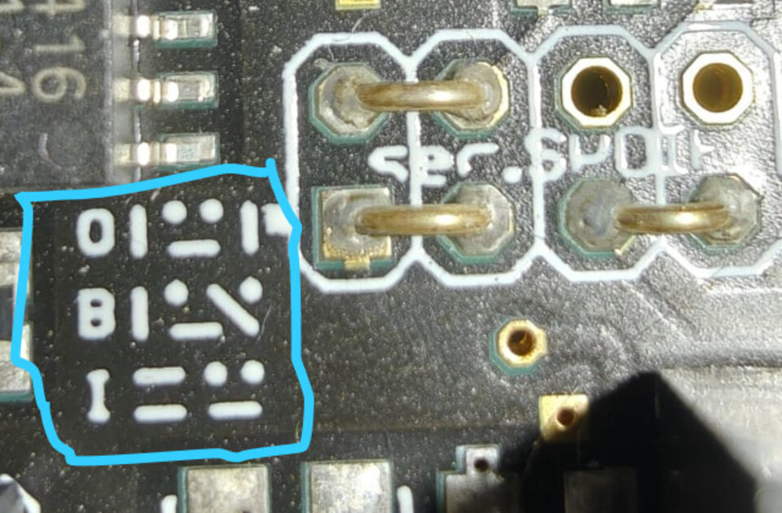

# Hardware-Referenz

Befunde zur Platine, die für Einstellungen und Umbauten gebraucht werden. Was am Gerät geprüft ist, steht mit
Gerät und Datum dabei; der Rest stammt aus Schaltplan, Datenblättern oder der Firmware und ist so gekennzeichnet.
Geprüft wurde am DEV-Forge: 96ELN, PCB 4.0.

## Anschlüsse am PC

| Gerät | USB-ID | Zweck |
|---|---|---|
| Silicon Labs CP2102 | `10c4:ea60` | Steuerung (USB-COM): Protokoll mit 38400 Bd, schnelle Rate per `system.baud.usb`, Bootloader |
| XMOS | `20b1:3066` | USB-Audio (zwei Kanäle, I²S an den ersten CT7302, Eingang RX5) |

Die Android-App öffnet nur den CP2102 (gui-ng#37), nie ein anderes USB-Seriell-Gerät.

## Optische Anschlüsse und Lötjumper „sec.spdif“ (JP1)

Der optische Port 2 kann Eingang oder Ausgang sein. Die Funktion legen das bestückte Modul und der Lötjumper
„sec.spdif“ (JP1, 2 × 4 Pads) fest. Neben den Pads steht die Legende **O / B / I**: Jede Zeile zeigt das Pad-Feld
verkleinert, Punkte sind offene Pads, Striche gesetzte Brücken.

Pins spaltenweise, unten 1/3/5/7, oben 2/4/6/8 (aus dem Schaltplan, Legende am DEV-Forge abgeglichen, 17.11.2026):

| Pin | Signal |
|---|---|
| 1 | GND |
| 2 | Modul Port 2, Pin 1 |
| 3 | Modul Port 2, Pin 2 |
| 4 | `IN.SPDIF.3` (Eingang des ersten CT7302) |
| 5 | 3,3 V |
| 6 | Ausgang des Empfängers an Port 1 |
| 7 | Modul Port 2, Pin 3 |
| 8 | `OUT.SPDIF.1` (S/PDIF-Ausgang des CT7302 an 0x22) |

| Stellung | Brücken | Modul an Port 2 | Funktion |
|---|---|---|---|
| **I** (ab Werk) | 2–4, 1–3, 5–7 | Empfänger TORX147PL | Port 2 ist Digitaleingang |
| **O** | 1–2, 3–5, 7–8 | Sender TOTX147PL | Port 2 sendet den Ausgang des CT7302 an 0x22, siehe [S/PDIF-Ausgang](spdif-out.md) |
| **B** | 1–2, 3–5, 6–7 | Sender TOTX147PL | Port 2 sendet direkt, was der Empfänger an Port 1 bekommt (optisches Durchschleifen ohne Chip und DSP) |

Nie gleichzeitig 1–3 und 3–5 brücken: Das verbindet 3,3 V mit GND.

### Module (Datenblätter Toshiba)

| Modul | Pin 1 | Pin 2 | Pin 3 | Versorgung |
|---|---|---|---|---|
| TORX147PL (Empfänger, ab Werk an Port 2) | Output | GND | Vcc | 2,7–3,6 V, max. 4,5 V |
| TOTX147PL (Sender) | GND | Vcc | Input | 2,7–3,6 V, max. 4,5 V |

Beide passen auf dieselben Pads (Haltestifte Pin 4/5). Die LED des Senders leuchtet, solange sein Eingang high ist:
Mit S/PDIF-Daten leuchtet Port 2 dauerhaft, auch bei digitaler Stille. Kein Licht heißt: kein Sender, falsche
Stellung oder keine Daten am Pin.

Ein bestückter Empfänger an Port 2 war am DEV-Forge die Ursache für einen stummen S/PDIF-Ausgang (17.11.2026,
forge-dsp-firmware#82).

## S/PDIF-Bausteine (Comtrue CT7302)

Zwei SRC-Brücken am I²C-Bus 1. Ein CT7302 wählt per Register 4 (`SW_SEL_INPUT_CHANNEL`) genau einen Eingang;
alle seine Ausgänge (S/PDIF-Sender und I²S) tragen diesen Eingang.

| Adresse | Aufgabe in der Firmware |
|---|---|
| 0x20 | gewählter Digitaleingang zum DSP: S/PDIF 1–4 bzw. USB (I²S IN-0 = RX5, XMOS) |
| 0x22 | tastet die Eingänge reihum auf Signal ab (Ereignisse für die GUI); im DSP-Modus fest auf I²S IN-2 = `DA.IN.4` (Mixer-Zeilen 3/4 von Kern 1 = Ausgang 1/2 vor den Ausgangsketten), siehe [S/PDIF-Ausgang](spdif-out.md) |

Eingänge (Register 4, Bits 2:0): 0–4 S/PDIF IN-0…4, 5 I²S IN-0, 6 I²S IN-1, 7 I²S IN-2.

Anschluss der beiden CT7302 (Schaltplan Grundplatine V40 S. 3, Netznamen CT7302.1/.2; Zuordnung zu 0x20/0x22
am 96ELN PCB 4.0 gemessen, 21.11.2026):

| | CT7302.1 = 0x20 | CT7302.2 = 0x22 |
|---|---|---|
| S/PDIF IN-0 | `IN.SPDIF.0`: U.FL „EXT-SPDIF“ (Original: Bluetooth) | gleich |
| S/PDIF IN-1 | `IN.SPDIF.1` über JP2 (Original: USB extern) | gleich |
| S/PDIF IN-2 | `IN.SPDIF.2`: optischer Port 1 (über R22) | gleich |
| S/PDIF IN-3 | `IN.SPDIF.3`: optischer Port 2 in Stellung I (über JP1 2–4, R23) | gleich |
| S/PDIF IN-4 | `IN.SPDIF.4P/4N`: Koax | gleich |
| I²S IN-0 | `IN.I2S.BCLK/LRCLK/SDATA.0` über JP2 „USB I2S“ (XMOS, `mixer.in=2`) | gleich |
| I²S IN-2 | `DSP.BCLK.IN`, `DSP.LRCLK`, `DA.IN.4` (Kern 1 DO7/DO8 = Mixer-Zeilen 3/4, Ausgang 1/2 vor Kern 3) | gleich, Quelle für `system.spdif.out=1` |
| I²S-Ausgang | `CT7302.1.SDATA` → DSP-Digitaleingang G7/G8, Takt vom DSP (I²S-Slave per Power-on-Latch) | `CT7302.2.SDATA` → DSP (nur Vierkanal-Option) |
| S/PDIF-Ausgang | `OUT.SPDIF.0`, nicht angeschlossen | `OUT.SPDIF.1` → JP1 Pad 8 → optischer Port 2 (Stellung O) |
| XTAL_IN | `CT7302.MCLK` vom Oszillator Q-OZ-2 (über R18, U.FL „MCLK-SPDIF“); Latch: 12,288 MHz | gleich |
| STATUS/DSD-MODE/INT | Port-Expander PCA9554 (U1) an I²C 1 | gleich |

Beide Bausteine sehen dieselben Eingänge; jeder wählt per Register 4 genau einen davon. 0x20 liefert den
gewählten Digitaleingang an den DSP (`mixer.in`). 0x22 tastet im Original die Eingänge für die Signal-Ereignisse
ab, im Vierkanal-Modus ist er der zweite Empfänger, mit `system.spdif.out=1` sendet er den DSP-Ausgang an Port 2.

Optischer Port 1 (Toslink-Eingang) = S/PDIF IN-2 von 0x20 = `mixer.in=3` (Firmware: `mixer.in` − 1 = Register 4,
2 = USB über I²S IN-0). Digital L kommt auf G8, R auf G7. Gemessen am 96ELN PCB 4.0 am 21.11.2026 mit einem
Testton über eine externe Karte mit optischem Ausgang: nur bei `mixer.in=3` fällt das Stille-Flag (0x7A = 0x05),
IN-0/3/4 und USB still.
SRC-Modus (Register 4, Bits 6:4) und Zielrate (Register 5) im Datenblatt CT7302 V0.11, S. 13–14 und 30–31.
Der Startwert der Firmware (Register 4 = 0x01, Modus 0) lässt die Ausgangsrate dem Referenztakt am Pin
`ASRC_REF_CLK_IN` folgen; was dort anliegt, ist nicht belegt.

Register lesen am Gerät (Adresse dezimal): `get i2c.1.34.4` liest Register 4 des Bausteins an 0x22. Lesen ist
harmlos; Schreiben geht an der Firmware vorbei und gilt nur bis zum nächsten Start bzw. bis die Firmware das
Register selbst setzt.

## Offene Punkte

- `DA.IN.4` ist am 96ELN PCB 4.0 Kern 1 DO7/DO8 (Mixer-Zeilen 3/4), nicht der Ausgang von Kern 2/3 (gemessen 21.11.2026, [spdif-out.md](spdif-out.md)). An einem zweiten Gerät und an 96ELN-3/CORE D8 nicht geprüft.
- Beschaltung von `ASRC_REF_CLK_IN` an beiden CT7302.
